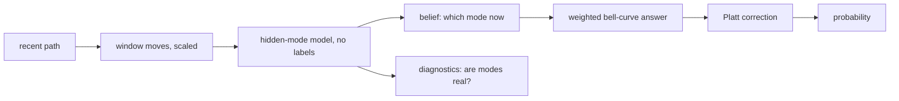
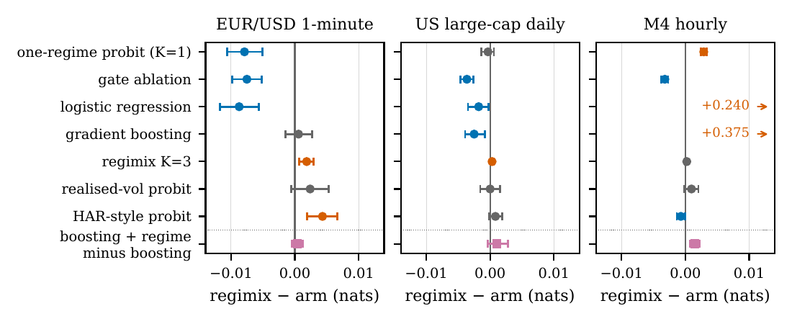
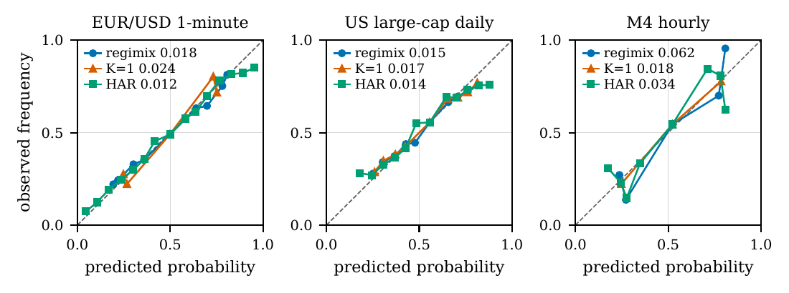

# regimix: calibrated "will it end above k?" probabilities from a path whose activity switches

<p align="center">
  <a href="https://x.com/tr4m0ryp"></a>
  <a href="paper/regimix.pdf"></a>
</p>

**Two hmmlearn 0.3.3 fixes (a silent variance collapse in the M-step, the wrong shape of spherical `covars_`), a
batched HMM fit that runs 130x faster than hmmlearn on 10^5 short paths with the same estimates, and diagnostics
that tell you when the regimes are fake. As a forecaster it has no edge: it ties a plain realised-volatility
probit on all three public datasets and beats the one-regime probit on EUR/USD only (-0.0079 nats, SE
0.0014).**

```bash
pip install "git+https://github.com/tr4m0ryp/regimix"
```

```python
from regimix import RegimeExceedanceClassifier, segments_from_path, diagnostics
Z = segments_from_path(x, None, t, edges=[0, 1, 3, 7, 15, 31])      # recent increments per lookback window
clf = RegimeExceedanceClassifier(n_states=2).fit(Z, y, distance=d, horizon=h)
p = clf.predict_proba(Z_new, distance=d_new, horizon=h)[:, 1]       # P(x[t + h] > threshold)
print(diagnostics.report(clf, Z_new, distance=d_new, horizon=h).summary())  # are the regimes real?
```

`x` is one long path (or use `segments_from_cumulative` for many short ones), `t` the decision indices, `d` the
signed distance of the current value above the threshold, `h` the remaining horizon, `y` the 0/1 outcome. A full
synthetic run is in `examples/quickstart.py`.

<details>
<summary>How the model works, in plain words</summary>

Picture a road that is sometimes quiet and sometimes in rush hour. You stand at a crossing and want to know:
will a car be past the next corner within ten seconds? The answer depends less on the cars you see right now
than on which mode the road is in. In rush hour things move fast and far; in the quiet hours they barely move.
If you can tell which mode you are in, you can give a much better answer.

regimix does this for any number that wanders over time: a price, a sensor reading, a queue length, a load
curve. You give it the last stretch of the path and a threshold, and it gives you a probability that the value
will be above that threshold some time later.

**Step 1: cut the recent past into windows.** It looks at how much the value moved over the last 1 step, the
3 steps before that, the 7 before that, and so on. Each move is divided by the square root of its window length,
so a calm and a busy window can be compared on the same scale.

**Step 2: learn the modes without any labels.** A hidden Markov model (a model with unseen switching states)
looks at thousands of those window sequences and finds, on its own, that there are, say, two kinds of
behaviour: small moves and large moves, each with its own typical spread and its own habit of staying put. It
never sees the outcomes you want to predict, so it cannot cheat.

**Step 3: guess the current mode.** For a new path it reads the windows from oldest to newest and keeps a
running belief: 80 % quiet, 20 % busy. It then steps that belief one step forward, since the mode can change.

**Step 4: ask each mode the question.** Under each mode the value is treated as a random walk with that mode's
spread. A random walk gives a clean bell-curve answer to "how likely is it to end above the threshold?". The
final answer is the average of the per-mode answers, weighted by the belief from step 3.

**Step 5: correct for bias.** A small two-number correction (Platt scaling) is fitted on outcomes, using
predictions from models that did not see those rows, so the probabilities mean what they say: things called
70 % happen about 70 % of the time.

**Step 6: check the modes are real.** If the model's "modes" switch every step or have nearly the same spread,
they are noise, and the diagnostics say so. On one dataset here (M4) they did, and that is exactly where regimix
lost to the one-mode model. A clean report is no promise of a gain: on the equities the modes passed and
regimix still only tied the one-mode model.



What it found: on EUR/USD the modes help over a model that assumes one fixed spread (on equities that is a tie,
on M4 a loss). But a plain "how jumpy has it been
lately?" estimate does just as well, and on EUR/USD a HAR-style version of it does better. Our reading, not
tested, is that two modes are a coarse copy of a smooth volatility level.

</details>

## Method

An episode $`i`$ is a scalar process $`X`$ seen up to time $`t_i`$, a threshold $`k_i`$ and a horizon
$`\tau_i > 0`$. The label is $`y_i = \mathbf{1}\{X(t_i+\tau_i) > k_i\}`$. With lookback edges
$`0 = e_0 < e_1 < \dots < e_S`$:

```math
z_{i,s} = \mathrm{clip}\!\left(\frac{X(t_i-e_{s-1})-X(t_i-e_s)}{\sqrt{e_s-e_{s-1}}},\,-c,\,c\right), \qquad
w_i = \alpha_{i,S}\,A, \qquad \alpha_{i,S}(j) = P(r_S = j \mid z_{i,1},\dots,z_{i,S})
```

```math
\tilde p_i = \sum_{j=1}^{K} w_i(j)\,\Phi\!\left(\frac{d_i+\mu_j\tau_i}{\max(\sigma_j,\sigma_{\min})\sqrt{\tau_i}}\right),
\qquad d_i = X(t_i)-k_i, \qquad
p_i = \mathrm{sigmoid}\big(a + b\,\mathrm{logit}\tilde p_i\big)
```

- **HMM:** $`K`$ Gaussian states fitted by Baum-Welch on the segment sequences of all episodes, without labels;
  $`\alpha`$ is the forward filter (Hamilton 1989), batched over episodes, moved one step ahead by the transition
  matrix $`A`$. Drift $`\mu_j = 0`$ by default.
- **Calibration:** $`(a, b)`$ is fitted on out-of-fold outputs from 5 contiguous time-block folds; the HMM is then
  refitted on all training rows. Labels enter only here.
- **Variance floor:** hmmlearn 0.3.3 applies `min_covar` only at initialisation, so on data with many exact zeros
  one state collapses onto a spike and its posterior becomes a one-bit gate. `FlooredGaussianHMM` applies it
  after every M-step, which is the exact constrained maximiser, so EM stays monotone (proof in the paper):

```math
v_j \leftarrow \max\!\left(v_j^{\mathrm{EM}},\, m\right)
```

- **Diagnostics:** collapse ratio, mean dwell and spread ratio; a dwell below 2 segments or a spread ratio below 2
  triggers a warning.

```math
\rho = \frac{\min_j v_j}{m}, \qquad D_j = \frac{1}{1-A_{jj}}, \qquad R = \frac{\max_j \sigma_j}{\min_j \sigma_j}
```

The estimator also returns $`w_i`$ and $`\mathrm{logit}\tilde p_i`$ for use as inputs to another learner.
The filter and the regime-weighted normal tail are known (Hamilton 1989; Hardy 2001). What is new here is
engineering: the two hmmlearn fixes, the batched fit and the diagnostics. The out-of-fold calibration is a
design choice with no clear measured gain over in-sample Platt (mixed sign, at most 0.0008 nats).

## Results

Held-out log-loss in nats on the last 30 % of time (never shuffled, one-horizon embargo), mean of 3 seeds. In
brackets: regimix minus arm, with a paired moving-block bootstrap SE (M4: a series bootstrap). **Negative means
regimix is better.**

| arm | EUR/USD 1-min (n = 13,078) | US large-cap daily (n = 22,125) | M4 hourly (n = 23,288) |
|---|---|---|---|
| **regimix** (K = 2) | **0.6201** | **0.6505** | **0.5878** |
| one-regime pooled probit (K = 1) | 0.6280 (-0.0079 ± 0.0014) | 0.6508 (-0.0003 ± 0.0005) | 0.5849 (+0.0029 ± 0.0002) |
| realised-vol probit | 0.6177 (+0.0024 ± 0.0015) | 0.6505 (+0.0000 ± 0.0008) | 0.5869 (+0.0010 ± 0.0006) |
| HAR-style probit | 0.6158 (+0.0043 ± 0.0012) | 0.6496 (+0.0008 ± 0.0005) | 0.5885 (-0.0007 ± 0.0003) |
| gate ablation (one-hot regime) | 0.6276 (-0.0075 ± 0.0012) | 0.6541 (-0.0036 ± 0.0005) | 0.5910 (-0.0032 ± 0.0003) |
| logistic regression | 0.6288 (-0.0087 ± 0.0016) | 0.6523 (-0.0018 ± 0.0008) | 0.3476 (+0.2402 ± 0.0049) |
| gradient boosting | 0.6195 (+0.0006 ± 0.0010) | 0.6530 (-0.0025 ± 0.0008) | 0.2126 (+0.3752 ± 0.0053) |
| pristine hmmlearn 0.3.3 EM | identical | identical | identical |
| boosting + regime outputs, minus boosting | +0.0004 ± 0.0004 | +0.0011 ± 0.0008 | +0.0015 ± 0.0004 |

- **On EUR/USD** (dwell 19.6 / 8.7 segments, spread ratio 3.4), regimix beats the one-regime probit and the gate
  ablation clearly, ties the realised-vol probit and loses to the HAR-style probit.
- **On equities** the regimes also pass the diagnostics (dwell 14.9 / 3.9, spread ratio 2.7), yet regimix ties
  the one-regime probit and both volatility probits: passing the diagnostics does not guarantee a gain.
- **No dataset** gives regimix a win over the best volatility probit. On M4 it narrowly beats the HAR-style probit
  (95 % interval -0.0013 to -0.00005), but the better probit there, realised vol, is a tie.
- **Where they are not** (M4: dwell 1.0 / 1.3, spread ratio 1.09), the diagnostics warn, and regimix loses to K = 1.
- **As extra inputs** to gradient boosting, the regime outputs never helped and hurt on M4.
- **The floor never binds** on these public data (smallest stock variance 4.8x to 30x the floor), so its evidence
  is the synthetic repro in `patches/hmmlearn/`: stock hmmlearn ends at 0.002x its own floor.
- **Speed** (`bench/results/speed.json`, synthetic 5-segment sequences, 10 EM iterations, one thread): the batched
  fit is 41x faster than hmmlearn's `fit` on 1,000 sequences, 139x on 10,000 and 131x on 100,000 (3.2 s against
  417 s). Its parameters differ from hmmlearn's by at most a relative 2.4e-13.

Full record, cuts and diagnostics: `bench/results/SCOPE.md`; raw numbers: `bench/results/*.json`.

<p align="center"></p>
<p align="center"><em>Paired held-out log-loss difference, regimix minus arm, 95 % bootstrap intervals.</em></p>

<p align="center"></p>
<p align="center"><em>Reliability diagrams of the seed-averaged held-out probabilities.</em></p>

## Limits

- **It lost a comparison.** A realised-volatility probit with no hidden states reads the volatility level as well
  as the regimes do. To beat it the regimes must carry what the level misses, such as a switch inside the horizon,
  which regimix does not model.
- **Three datasets:** nothing here says how it does on other data.
- **Thin evidence:** one held-out period per dataset, 3 seeds, post-hoc variants on that same period (none won on
  all three datasets), survivorship bias in the equity universe, and synthetic-only evidence for the floor and
  the speed-up (one machine).
- **`drift=True`** reads the segment mean per square-root time while the mixture expects it per unit time; it loses
  heavily on equities and M4. Keep drift off.
- **One-feature HMMs only** in the batched fit.

## Reproduce

```bash
git clone https://github.com/tr4m0ryp/regimix && cd regimix
python -m venv .venv && .venv/bin/pip install -e ".[test]" matplotlib
.venv/bin/python -m pytest                       # package tests and the hmmlearn patch repros
.venv/bin/python examples/quickstart.py          # synthetic data with a known answer
PY=.venv/bin/python bash bench/run_all.sh        # all three benchmarks + variants, about 1 h on 2 threads
.venv/bin/python -m bench.run_speed              # batched fit against hmmlearn, about 8 min on 1 thread
for d in fx eq m4; do .venv/bin/python -m paper.results.ablate_calib $d; done   # calibration ablation
.venv/bin/python paper/results/make_numbers.py   # paper numbers from bench/results
.venv/bin/python paper/figures/make.py           # paper figures
```

Data downloads to `$REGIMIX_DATA` (default `../_data`, outside the repo): HistData EUR/USD 1-minute bars,
Yahoo Finance daily closes and the M4 hourly files. Raw held-out predictions go to `_data/regimix_predictions/`.

## Cite

```bibtex
@misc{ouallaf2026regimix,
  author = {Ouallaf, Moussa},
  organization = {Husimi.ai},
  title  = {Regime-mixture exceedance probabilities from a partly observed path, with collapse diagnostics},
  year   = {2026},
  howpublished = {\url{https://github.com/tr4m0ryp/regimix}},
  note   = {Paper: paper/regimix.pdf}
}
```

## License

regimix is **source-available**, licensed under the [PolyForm Noncommercial License 1.0.0](./LICENSE), **not** an
OSI open-source license.

- **You may** use, modify, fork, and share regimix freely for any **noncommercial** purpose, as long as you keep the
  copyright and `Required Notice:` lines (see [`NOTICE`](./NOTICE)) and credit *"regimix by Keygraph, Inc."*
- **You may not** sell it, bundle it into a paid product, or run it as a paid/hosted service **without a commercial
  license**.

**Exception:** the two patch files `patches/hmmlearn/*.patch` modify hmmlearn source and stay under hmmlearn's
BSD 3-Clause license ([`patches/hmmlearn/LICENSE`](./patches/hmmlearn/LICENSE)), so they can go upstream. The
`regimix` package itself copies no hmmlearn code; it imports hmmlearn as a dependency.

Copyright (c) 2026 Keygraph, Inc. Commercial licensing enquiries: see [`NOTICE`](./NOTICE).
